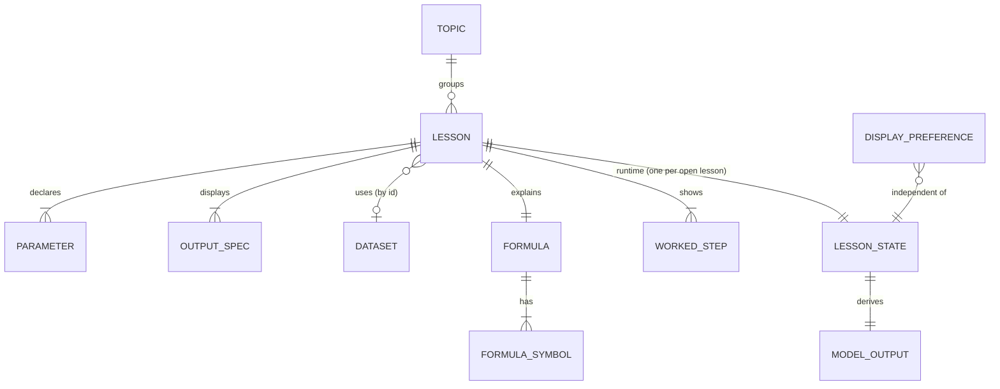
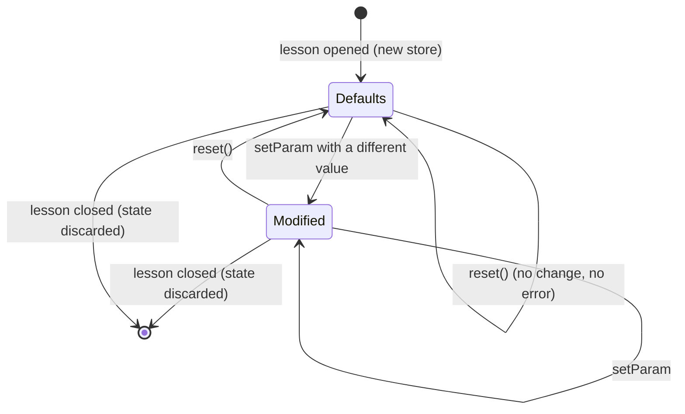

# Data Model: Lesson Framework and Foundation Lessons

Entities come from the spec's Key Entities. Lesson content is static JSON and Markdown validated at load time.
Runtime state is held by Zustand stores. Nothing is persisted.

## Entity overview



## Topic

Defined in `src/sim/content/topics.ts`, in this fixed order.

| Field | Type | Rules |
|-------|------|-------|
| `id` | `"foundations" \| "optimization" \| "models" \| "neural-networks"` | Unique, one of the four values |
| `title` | string | "Foundations", "Optimization", "Models", "Neural Networks" |
| `order` | integer | 1 to 4, unique |

Lessons are grouped by `topic`. A topic with zero lessons is listed as "coming soon" and has no link (FR-002).

## Lesson

Loaded from `src/content/lessons/<topic>/<id>/lesson.json`, plus `intuition.md` in the same folder.

| Field | Type | Rules |
|-------|------|-------|
| `id` | string | kebab-case, equals the folder name, unique across all lessons, used in the URL |
| `topic` | TopicId | Must exist, and the folder's parent must match |
| `order` | integer ≥ 1 | Unique within its topic |
| `title` | string | 1 to 60 characters |
| `summary` | string | 1 to 160 characters, shown in the list |
| `model` | `{ id, bind? }` | `id` must be in the model registry. `bind` maps each model role to a parameter id and must cover every role the model declares |
| `datasetId` | string, optional | Required if the model needs data. Must match a file in `src/content/datasets/` |
| `chart` | `{ type, options? }` | `type` must be in the chart registry. `options` must satisfy that chart's contract (see [contracts/chart-types.md](./contracts/chart-types.md)) |
| `parameters` | Parameter[] | At least 1. Ids unique. Every id the model binds to must exist, and be a number parameter |
| `outputs` | OutputSpec[] | Keys must be produced by the model. At least 1 |
| `formula` | `Variant<Formula>` | Required. Every symbol that appears in `latex` must have an entry in `symbols` (Principle IV) |
| `workedExample` | `Variant<WorkedStep[]>` | Required, at least 1 step. Every `{{...}}` reference must resolve against the template context |
| `chartSummary` | `Variant<string>` | Required text alternative template (FR-017) |
| `intuition` | string | Loaded from `intuition.md`, must not be empty |

The schema in [contracts/lesson.schema.json](./contracts/lesson.schema.json) covers the structural rules. Cross-field
rules (bindings, template references, symbol coverage, unique ids) are enforced by the loader and tested in
`tests/unit/content/`.

### Variant

`Variant<T> = T | { variantBy: string; variants: Record<string, T> }`

- `variantBy` must name a `choice` parameter of the same lesson.
- `variants` must have exactly one key for every option of that parameter.
- At runtime the value for the current choice is selected before templates are filled.

## Parameter

A discriminated union on `type`.

### NumberParameter

| Field | Type | Rules |
|-------|------|-------|
| `type` | `"number"` | |
| `id` | string | Unique within the lesson, `[a-zA-Z][a-zA-Z0-9]*`, must not clash with an output key or a reserved template name |
| `label` | string | Plain-language name, shown to the learner |
| `symbol` | string, optional | LaTeX. Omitted when the symbol has not been introduced (the "Loss" lesson omits w and b) |
| `min`, `max` | number | `min < max`, both multiples of `step` |
| `step` | number > 0 | 0.1 in this feature |
| `default` | number | In `[min, max]` and a multiple of `step` from `min` |
| `control` | `"slider" \| "chart-handle" \| "both"` | `chart-handle` and `both` require a chart that exposes a handle for this parameter |

### ChoiceParameter

| Field | Type | Rules |
|-------|------|-------|
| `type` | `"choice"` | |
| `id` | string | As above |
| `label` | string | |
| `options` | `{ value, label }[]` | At least 2, unique `value`s |
| `default` | string | Must be one of the option values |

### Input handling rules (FR-013)

- A number is snapped to the nearest step from `min`, then clamped to `[min, max]`.
- A typed value that is not a finite number is rejected, the previous value is kept, and the rejection message
  names the allowed range (for example "Enter a number from -3.0 to 3.0").
- A typed value that is a number but out of range is clamped, with the same message shown.
- Displayed parameter values always have 1 decimal place.

## Dataset

Loaded from `src/content/datasets/<id>.json`.

| Field | Type | Rules |
|-------|------|-------|
| `id` | string | Equals the file name, unique |
| `label` | string | Shown in the chart summary if needed |
| `points` | `{ x: number, y: number }[]` | 1 to 10 points, finite numbers, read-only, same every time the lesson opens |

Datasets shipped in this feature:

| id | Points | Used by |
|----|--------|---------|
| `loss-3` | (1, 2), (2, 4), (3, 5) | Loss |
| `weight-bias-4` | (1, 3), (2, 5), (3, 7), (4, 8) | Weight and bias |

## OutputSpec

Controls how a model output is displayed.

| Field | Type | Rules |
|-------|------|-------|
| `key` | string | Must be a key the model returns |
| `label` | string | Plain-language name |
| `symbol` | string, optional | LaTeX |
| `decimals` | integer 0 to 6 | Decimals used everywhere this value is shown, including templates |

## Formula and FormulaSymbol

| Field | Type | Rules |
|-------|------|-------|
| `latex` | string | KaTeX-compatible. May use `{{...}}` only if it is also valid after substitution |
| `symbols` | `{ symbol: string, meaning: string }[]` | `symbol` is LaTeX. `meaning` is plain language. No empty meanings |

## WorkedStep

| Field | Type | Rules |
|-------|------|-------|
| `text` | string | Plain-language sentence, may use templates |
| `latex` | string | Display math with templates substituted before KaTeX renders it |

## ModelOutput and Model (core contract)

```ts
type ModelOutput = Record<string, number | number[]>;

interface Model {
  id: string;
  roles: string[];                 // numeric roles that must be bound to parameters
  needsDataset: boolean;
  outputKeys: string[];            // every key compute() returns
  compute(
    input: { values: Record<string, number>; choices: Record<string, string> },
    dataset?: Point[],
  ): ModelOutput;
}
```

Models shipped in this feature:

| Model id | Roles | Choice inputs | Outputs |
|----------|-------|---------------|---------|
| `slope-of-curve` | `x` | `curve` (`x2`, `x3`, `sin`) | `y`, `slope`, `tangentIntercept`, `curveX[]`, `curveY[]`, `tangentX[]` (2 values), `tangentY[]` (2 values) |
| `line-loss` | `slope`, `intercept` | none | `n`, `predictions[]`, `errors[]`, `squaredErrors[]`, `mse`, `lineX[]` (2 values), `lineY[]` (2 values) |

Definitions: `error = prediction − actual`, `squaredError = error²`, `mse = sum(squaredErrors) / n`.

## LessonState (runtime, one store per open lesson)

| Field | Type | Meaning |
|-------|------|---------|
| `lesson` | Lesson | Immutable |
| `dataset` | Point[] or undefined | Immutable |
| `params` | `Record<string, number \| string>` | Current value of every parameter |
| `outputs` | ModelOutput | Result of the model for `params`, always in sync |
| `setParam(id, raw)` | action | Validates, snaps, clamps, recomputes. Returns `{ ok: true }` or `{ ok: false, message }` |
| `reset()` | action | Sets every parameter to its default and recomputes |

State transitions:



Invariants:

- `outputs` is always `model.compute(params, dataset)`, so a render never mixes values from two parameter sets.
- Every value in `params` is a snapped, in-range value (or a valid option for a choice).
- `setParam` with a rejected value leaves `params` and `outputs` unchanged.
- Changing a choice parameter recomputes immediately. A number parameter that is still in range keeps its value
  (for example the point stays at the same x when the curve changes).

## DisplayPreference (global)

| Field | Type | Meaning |
|-------|------|---------|
| `theme` | `"light" \| "dark"` | Initial value from the system setting. Held in memory, so it persists while navigating and is not saved across reloads |
| `toggle()` | action | Switches theme and updates the root element's `data-theme` |

`reset()` in a lesson never changes the theme.

## Template context

Used by `workedExample`, `chartSummary` and any templated text. See
[contracts/model-and-template.md](./contracts/model-and-template.md).

| Name | Source | Formatting |
|------|--------|------------|
| each parameter id | `params` | 1 decimal for numbers, option label for choices |
| each output key | `outputs` | `decimals` from its `OutputSpec` |
| `dataX`, `dataY` | dataset points | Shown as stored, with trailing zeros trimmed |

## Worked reference example (for orientation)

A trimmed `weight-and-bias/lesson.json`:

```json
{
  "id": "weight-and-bias",
  "topic": "foundations",
  "order": 3,
  "title": "Weight and bias",
  "summary": "Change w and b to move a line and watch the loss.",
  "model": { "id": "line-loss", "bind": { "slope": "w", "intercept": "b" } },
  "datasetId": "weight-bias-4",
  "chart": { "type": "line-fit", "options": { "slopeParam": "w", "interceptParam": "b" } },
  "parameters": [
    { "type": "number", "id": "w", "label": "Weight", "symbol": "w", "min": -3, "max": 3, "step": 0.1, "default": 1, "control": "slider" },
    { "type": "number", "id": "b", "label": "Bias", "symbol": "b", "min": -5, "max": 5, "step": 0.1, "default": 0, "control": "slider" }
  ],
  "outputs": [
    { "key": "mse", "label": "Loss (MSE)", "symbol": "L", "decimals": 3 },
    { "key": "predictions", "label": "Predictions", "symbol": "\\hat{y}", "decimals": 2 }
  ],
  "formula": {
    "latex": "\\hat{y} = w x + b \\qquad L = \\frac{1}{n}\\sum_{i=1}^{n}(\\hat{y}_i - y_i)^2",
    "symbols": [
      { "symbol": "x", "meaning": "the input value" },
      { "symbol": "w", "meaning": "the weight: how steeply the line rises for each step in x" },
      { "symbol": "b", "meaning": "the bias: the height of the line where x is 0" },
      { "symbol": "\\hat{y}", "meaning": "the prediction the line makes for x" },
      { "symbol": "y_i", "meaning": "the real value of point i" },
      { "symbol": "n", "meaning": "the number of data points" },
      { "symbol": "L", "meaning": "the loss: the average squared miss" }
    ]
  },
  "workedExample": [
    { "text": "Predict y for the first point using the current w and b.", "latex": "\\hat{y}_1 = {{w|paren}} \\cdot {{dataX[0]}} + {{b|paren}} = {{predictions[0]}}" },
    { "text": "Average the squared errors of all {{n}} points.", "latex": "L = \\frac{ {{squaredErrors[]| + }} }{ {{n}} } = {{mse}}" }
  ],
  "chartSummary": "Line y = {{w}}x + {{b}} over {{n}} points. Loss is {{mse}}."
}
```
