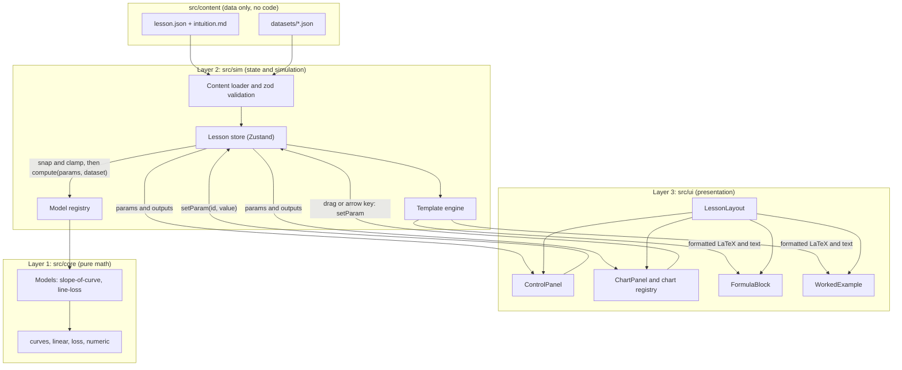
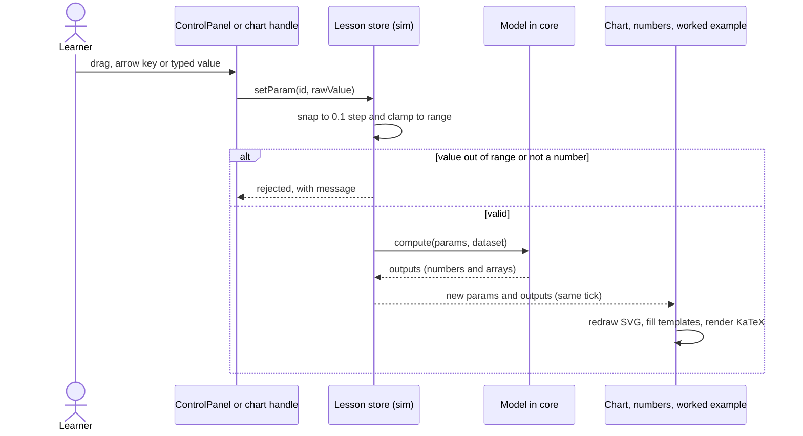

# Implementation Plan: Lesson Framework and Foundation Lessons

**Branch**: `001-lesson-framework-foundations` | **Date**: 2026-11-05 | **Spec**: [spec.md](./spec.md)

**Input**: Feature specification from `/specs/001-lesson-framework-foundations/spec.md`

## Summary

Build a fully client-side static site in which a learner browses lessons grouped by topic, opens a lesson
and manipulates parameters while the chart, numbers, formula and worked example update live. Three
foundation lessons ship with it: Function and slope, Loss, and Weight and bias.

The approach is a data-driven lesson engine with the three layers required by the constitution:

- `src/core/` holds pure TypeScript math (curves and their exact derivatives, linear model, residuals, MSE,
  step snapping). It has no React or DOM imports.
- `src/sim/` holds Zustand state (parameters, derived outputs, reset, theme), the lesson loader and the
  worked-example template engine.
- `src/ui/` holds React components and D3-powered SVG charts.

Each lesson is a content folder (`lesson.json` plus `intuition.md`). Parameters, ranges, steps, defaults, the
model to call, the chart type, formula symbols, worked-example templates and chart text summaries are all
declared in that content. Adding a lesson that reuses existing models and chart types needs content files only.

## Technical Context

**Language/Version**: TypeScript (strict mode, current stable release), Node.js 22+ for tooling (24 is installed locally)

**Primary Dependencies**: React 19, Vite, Zustand 5, d3-scale + d3-shape (SVG charts rendered by React, no
full D3 bundle), KaTeX, react-markdown + remark-math + rehype-katex (intuition text), react-router-dom 7
(hash router), zod (content validation)

**Storage**: None. Lesson content is bundled static files. Nothing is persisted (accounts and saved progress are
out of scope, and refresh always restores defaults per FR-009).

**Testing**: Vitest, React Testing Library with user-event, jsdom, vitest-axe (accessibility smoke checks),
NumPy-generated reference fixtures for the math core

**Target Platform**: Current desktop and tablet-landscape browsers (viewport 1024 px and wider); deployed as
static files to any static host

**Project Type**: Single-project client-side web application (static site, no backend)

**Performance Goals**: Control change to updated chart, numbers and worked example in under 100 ms (target
under 16 ms so dragging stays at 60 fps), with synchronous updates and no debouncing

**Constraints**: Offline-capable after first load (no runtime network calls), no web fonts or CDN assets
required, keyboard-operable controls, colour-blind-safe palette, light and dark themes

**Scale/Scope**: 3 lessons, 4 topics, at most about 10 data points per lesson, 3 chart types in the registry
(2 used) and a few hundred curve sample points

## Constitution Check

*GATE: Must pass before Phase 0 research. Re-check after Phase 1 design.*

| # | Principle | Status | How this plan satisfies it |
|---|-----------|--------|----------------------------|
| I | Learn by Manipulation | PASS | Every lesson declares at least one control. Store updates are synchronous, and no debounce is allowed on the control-to-chart path. A timing test asserts the 100 ms budget. |
| II | Training Is Visible | N/A | This feature has no iterative algorithm. Play, step and history controls arrive with the training-animation feature. |
| III | Math Correctness First | PASS | All math lives in `src/core/` with no UI imports. Charts only draw model outputs, with no hard-coded visuals. Core results are checked against hand-computed values and NumPy fixtures at a stated tolerance of 1e-9. |
| IV | Intuition Before Formalism | PASS | `LessonLayout` renders sections in a fixed order: intuition, demo, formula, worked example. The content schema requires symbol explanations, and a content test fails any lesson that omits one. |
| V | Test-First Quality | GATE | Test cases are listed in [test-cases.md](./test-cases.md) and need your approval before implementation starts. Tasks must write failing tests first. |
| VI | Simplicity and Separation | PASS with scoped deferrals | Three layers with downward-only imports, enforced by lint rules (see Architecture). `gradient`, history and playback from the stack brief are deferred because no lesson here needs them. |
| VII | Accessible and Responsive | PASS | Handles are focusable `role="slider"` elements with arrow-key support. Charts have a text summary. The palette is colour-blind-safe (Okabe-Ito) and contrast is tested. Layout is verified at 1024 px and wider. |
| VIII | Performance Budget | PASS | Computation per update is far under 1 ms, so a Web Worker is not warranted (it would add async lag). Decision to revisit when training lessons arrive. |
| IX | Branch-per-Feature Git Workflow | PASS | Work is on `001-lesson-framework-foundations`, which matches the feature folder. |

**Deviation from the stack brief (Principle VI, YAGNI)**:

- `gradient` in the core and the history/playback parts of the sim layer are not built here. The three lessons
  have no iterative algorithm, so nothing would call them. They are the first tasks of the training-animation
  feature.
- A numerical derivative is not part of the shipped core, because the spec requires the exact slope rule.
  A finite-difference helper lives in `tests/helpers/` only, as an independent cross-check of the exact rules.

**Post-design re-check (after Phase 1)**: all rows above still hold. The content engine adds no new layer. The
content directory is data only, and the app shell lives in `src/ui/app/`.

## Architecture

### Layers and data flow



Imports are one-way: `ui` may import `sim` and `core`, `sim` may import `core`, and `core` imports nothing from
the app. An ESLint `no-restricted-imports` rule enforces this, and a unit test fails if `src/core` imports
`react`, `zustand`, `d3-*` or any DOM global.

### Control change sequence



### How a lesson stays engine-independent

- Lessons are auto-discovered with `import.meta.glob("/src/content/lessons/**/lesson.json")`, so no list or
  route table is edited when a lesson is added.
- A lesson names a `model` and a `chart.type`. Both are looked up in registries (`src/sim/models.ts` for models,
  `src/ui/charts/chartRegistry.ts` for charts).
- A new lesson that reuses an existing model and chart type is content only. A lesson that needs new math adds
  one file in `src/core/models/` and one registry line. The engine (store, layout, controls, templates, router)
  is not edited either way.
- The content loader validates every lesson against the schema in [contracts/lesson.schema.json](./contracts/lesson.schema.json)
  at build and test time, and rejects mismatches between the chosen model, chart and declared parameters.

## Data Model (summary)

Full field rules, examples and state transitions are in [data-model.md](./data-model.md). The core shapes are:

```ts
type TopicId = "foundations" | "optimization" | "models" | "neural-networks";

interface Point { x: number; y: number }

interface Dataset {
  id: string;
  label: string;
  points: Point[]; // fixed, read-only; 1 to 10 points
}

interface NumberParameter {
  type: "number";
  id: string;                 // unique within the lesson, e.g. "x", "w", "b"
  label: string;              // plain-language name shown to the learner
  symbol?: string;            // LaTeX; omitted where a symbol is not yet introduced
  min: number;
  max: number;
  step: number;               // 0.1 for this feature
  default: number;
  control: "slider" | "chart-handle" | "both";
}

interface ChoiceParameter {
  type: "choice";
  id: string;
  label: string;
  options: { value: string; label: string }[];
  default: string;
}

type Parameter = NumberParameter | ChoiceParameter;

interface Lesson {
  id: string;                 // matches the folder name, used in the URL
  topic: TopicId;
  order: number;              // position within the topic
  title: string;
  summary: string;
  model: { id: string; bind?: Record<string, string> }; // bind maps model roles to parameter ids
  datasetId?: string;
  chart: { type: string; options?: Record<string, unknown> };
  parameters: Parameter[];
  outputs: { key: string; label: string; symbol?: string; decimals: number }[];
  formula: Variant<{ latex: string; symbols: { symbol: string; meaning: string }[] }>;
  workedExample: Variant<{ text: string; latex: string }[]>;
  chartSummary: Variant<string>;  // text alternative template
  intuition: string;              // loaded from intuition.md
}

// A value that depends on a choice parameter, for example the curve in "Function and slope".
type Variant<T> = T | { variantBy: string; variants: Record<string, T> };
```

## Project Structure

### Documentation (this feature)

```text
specs/001-lesson-framework-foundations/
├── plan.md              # This file
├── research.md          # Phase 0 decisions
├── data-model.md        # Phase 1 entities, rules, state
├── quickstart.md        # Phase 1 validation guide
├── test-cases.md        # Test inventory for approval (Principle V)
├── contracts/
│   ├── lesson.schema.json       # JSON Schema for lesson.json
│   ├── model-and-template.md    # Model contract and template syntax
│   └── chart-types.md           # Chart type contracts
├── checklists/
│   └── requirements.md
└── tasks.md             # Phase 2 output (/speckit-tasks, not created here)
```

### Source Code (repository root)

```text
math-lens/
├── index.html
├── package.json
├── vite.config.ts
├── tsconfig.json
├── eslint.config.js                 # layer-boundary rules
├── src/
│   ├── core/                        # Layer 1: pure TypeScript, no framework imports
│   │   ├── numeric.ts               # clamp, snapToStep, roundTo, compensated sum
│   │   ├── curves.ts                # x², x³, sin x: f(x) and exact derivative
│   │   ├── linear.ts                # predict(slope, intercept, x)
│   │   ├── loss.ts                  # residuals, squaredErrors, mse
│   │   ├── models/
│   │   │   ├── slopeOfCurve.ts      # outputs: y, slope, tangent, sampled curve
│   │   │   └── lineLoss.ts          # outputs: predictions, errors, squaredErrors, mse, line
│   │   ├── types.ts                 # Point, ModelOutput, Model
│   │   └── index.ts
│   ├── sim/                         # Layer 2: state and simulation (imports core only)
│   │   ├── content/
│   │   │   ├── schema.ts            # zod schemas matching contracts/lesson.schema.json
│   │   │   ├── loader.ts            # import.meta.glob discovery, validation, indexing
│   │   │   └── topics.ts            # the four topics and their order
│   │   ├── models.ts                # model registry: id to core model
│   │   ├── template.ts              # {{key}}, {{key[i]}}, {{key[]|sep}}, |paren
│   │   ├── lessonStore.ts           # params, outputs, setParam, reset
│   │   └── themeStore.ts            # light or dark, initial value from system setting
│   ├── ui/                          # Layer 3: presentation
│   │   ├── app/
│   │   │   ├── main.tsx
│   │   │   ├── App.tsx
│   │   │   └── routes.tsx           # hash routes: #/, #/lessons/:id, not-found
│   │   ├── components/
│   │   │   ├── LessonList.tsx       # topics with lessons or "coming soon"
│   │   │   ├── LessonLayout.tsx     # intuition, demo, formula, worked example
│   │   │   ├── ControlPanel.tsx     # sliders, number inputs, choice select, reset
│   │   │   ├── ChartPanel.tsx       # picks a chart from the registry, adds text summary
│   │   │   ├── FormulaBlock.tsx     # KaTeX formula and symbol table
│   │   │   ├── WorkedExample.tsx    # substituted steps
│   │   │   ├── IntuitionText.tsx    # Markdown with inline math
│   │   │   ├── ThemeToggle.tsx
│   │   │   └── NotFound.tsx
│   │   ├── charts/
│   │   │   ├── chartRegistry.ts     # chart type to component
│   │   │   ├── CurveTangentChart.tsx
│   │   │   ├── LineFitChart.tsx
│   │   │   ├── SliderHandle.tsx     # shared keyboard and pointer handle
│   │   │   └── palette.ts           # Okabe-Ito colours for both themes
│   │   └── styles/
│   │       ├── tokens.css           # CSS variables for light and dark
│   │       └── app.css
│   └── content/                     # Data only: no code
│       ├── datasets/
│       │   ├── loss-3.json
│       │   └── weight-bias-4.json
│       └── lessons/
│           ├── foundations/
│           │   ├── function-and-slope/{lesson.json, intuition.md}
│           │   ├── loss/{lesson.json, intuition.md}
│           │   └── weight-and-bias/{lesson.json, intuition.md}
│           ├── optimization/        # empty: shown as "coming soon"
│           ├── models/              # empty
│           └── neural-networks/     # empty
└── tests/
    ├── fixtures/
    │   ├── generate_reference.py    # NumPy script that writes reference-values.json
    │   └── reference-values.json
    ├── helpers/
    │   └── numericDerivative.ts     # test-only finite-difference cross-check
    ├── unit/
    │   ├── core/                    # one test file per core module
    │   ├── sim/                     # store, template, loader, layer boundaries
    │   └── content/                 # every lesson validates and meets its own schema
    └── component/                   # parameter-to-chart wiring, keyboard, themes, a11y
```

**Structure Decision**: A single-project layout with three source layers plus a data-only `content` folder.
There is no backend, so there is no `api/` or `backend/`. Empty topic folders are optional: topics come from
`topics.ts`, so they can be created when their first lesson is added.

## Complexity Tracking

> No constitution violations to justify. The deferrals listed under Constitution Check are reductions in scope,
> not added complexity.
