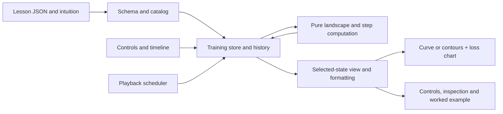

# Implementation Plan: Training Playback for Gradient Descent

**Branch**: `002-gradient-descent-playback` | **Date**: 2026-11-05 | **Spec**: [spec.md](./spec.md)

**Input**: Feature specification from `specs/002-gradient-descent-playback/spec.md`

## Summary

Extend the existing static lesson framework with three Optimization lessons: a convex 1D curve,
an asymmetric non-convex 1D curve, and a 2D contour map. A reusable playback engine records the
actual gradient descent states and transitions, replays or branches them according to the learner's
actions, and drives the charts, numerical inspection and worked example from the same selected
snapshot. A run retains its initial state and up to 1,000 updates. See [research.md](./research.md),
[data-model.md](./data-model.md), and [contracts](./contracts/).

## Technical Context

**Language/Version**: TypeScript 6, strict mode; Node.js 22+ for tooling.

**Primary Dependencies**: Existing React 19, Zustand 5, Vite 8, D3 scale/shape, Zod, KaTeX and
React Router. Add `d3-contour` and its types for data-derived 2D isolines; no 3D library.

**Storage**: In-memory per-lesson Zustand store. Lesson content remains bundled JSON/Markdown.
No persistence, server, accounts or external runtime services.

**Testing**: Vitest, React Testing Library, user-event, vitest-axe, independent hand/NumPy
fixtures and real-browser performance/accessibility checks. Test cases must be listed for user
approval before implementation, then written and observed failing first.

**Target Platform**: Current desktop and tablet browsers, 1024 px and wider, light/dark themes;
static deployment and hash routes as in the existing application.

**Project Type**: Client-side static web application; existing three-layer architecture.

**Performance Goals**: Every control, including scrubbing 1,001 states, updates visible charts
and numbers in under 100 ms; sustain 60 fps during the specified interactions. These are measured
on real desktop and tablet-class browsers, not inferred from timer delays.

**Constraints**: Exact gradients and real computations; no clamping of computed weights; finite
checks before accepting or plotting data; keyboard and chart text alternatives; no background
playback after navigation; worker if measurement shows main-thread computation blocks the UI.

**Scale/Scope**: Three new lessons, up to 1,000 updates plus initial state per run; 1D and 2D
weights, with contour only. More algorithms, 3D, persistence and data-fitting remain out of scope.

## Constitution Check

*Pre-research evaluation and post-design re-check; PASS means the design complies, not that implementation has been verified.*

| Principle | Status | Design and verification |
|-----------|--------|-------------------------|
| I. Learn by Manipulation | PASS | Start, rate, speed and timeline controls update selected-state views; benchmark actual input-to-render latency under 100 ms. |
| II. Training Is Visible | PASS | Play/pause, forward/back, reset, speed and timeline expose full state and transition history; replay and branching are specified in the playback contract. |
| III. Math Correctness First | PASS | Pure `src/core` evaluation, gradients and updates; test hand/NumPy references and overflow handling; charts sample real landscapes. |
| IV. Intuition Before Formalism | PASS | Preserve intuition → demo → formula → current-step worked example and explain all symbols. |
| V. Test-First Quality | GATE | Create and present the test-case inventory for user approval before implementing; TDD each task. Cover every new core function and parameter-to-chart behavior. |
| VI. Simplicity and Separation | PASS | Core is pure, simulation manages serializable snapshots/timers, presentation renders. A generic stepper interface exists because these lessons require it; no speculative optimizers. |
| VII. Accessible and Responsive | PASS | Keyboard-operable playback, start controls and timeline; SVG labels, summaries, patterns and color-blind-safe colors; test themes and tablet/desktop widths. |
| VIII. Performance Budget | GATE | Profile real 1,001-state scrub and drag at 60 fps. If computation blocks the UI, move the measured heavy work to a worker using serializable messages and explicit cancellation/stale-result handling. |
| IX. Branch-per-Feature Git Workflow | PASS | Branch matches the feature folder and the worktree was clean before planning. Commit planning work before the next gated command; follow the automatic post-analysis rule. |

Post-design: no architecture violation is knowingly introduced. Performance, accessibility and
test-first gates remain to be verified during implementation; a design pass is not a measured pass.

## Project Structure

### Documentation (this feature)

```text
specs/002-gradient-descent-playback/
├── spec.md
├── plan.md
├── research.md
├── data-model.md
├── contracts/
│   ├── playback.md
│   └── lesson-and-ui.md
├── quickstart.md
└── tasks.md              # later /speckit-tasks output
```

### Source Code (repository root)

```text
src/
├── core/                 # landscapes, exact gradients, finite-safe update and sampling
├── sim/
│   ├── content/          # existing schema/loader extended compatibly
│   ├── models.ts         # existing model registry
│   └── training/         # stepper adapter, history, playback store and scheduler
├── ui/
│   ├── components/       # existing lesson shell + training controls/inspection
│   └── charts/           # 1D loss, 2D contours, loss-vs-step
└── content/lessons/optimization/
    ├── gradient-descent-1d/
    ├── gradient-descent-nonconvex/
    └── gradient-descent-2d/
tests/
├── unit/core/            # gradients, step math, finite boundaries and references
├── unit/sim/             # playback state/history, timer cleanup, content validation
└── component/            # interaction, charts, accessibility, compatibility
```

**Structure Decision**: Extend existing `src/core`, `src/sim` and `src/ui`; the existing
`lessonSchema` is strict and `LessonLayout` always creates `lessonStore`, so add a
backwards-compatible training lesson variant and dispatch from the shared lesson route/layout.
Update loader validation, catalog, template context and chart integration together rather than
pretending new content works with the existing static-model contract. Keep all existing lessons
and routes working. Extend control formatting where necessary: the current controls format numeric
inputs to one decimal, which would incorrectly display the small `0.0005` rate as zero.

### Data flow



## Complexity Tracking

No constitutional violation is proposed. `d3-contour` is narrowly justified by the required 2D
contour lesson; the playback adapter is required to keep navigation and history independent of
the current gradient-descent algorithm. A worker is conditional on measured blocking, not an
additional architectural layer.
